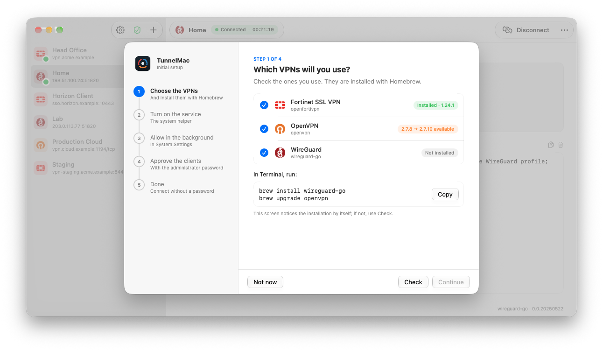
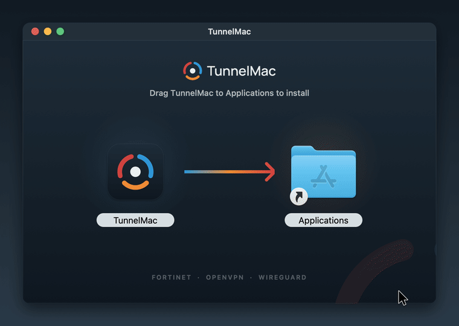
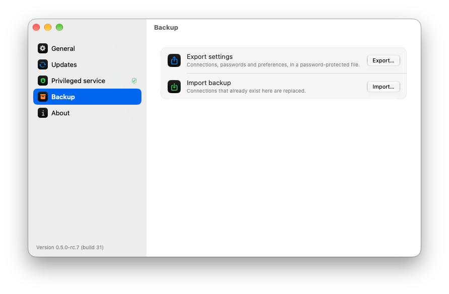

<p align="center">
  <picture>
    <source media="(prefers-color-scheme: dark)" srcset="TunnelMac-Brand/01-Logo/PNG/TunnelMac-logo-horizontal-color-dark.png">
    
  </picture>
</p>

<p align="center">
  <b>One native Mac app for your Fortinet, OpenVPN and WireGuard connections.</b><br>
  Connect from the menu bar. No admin password on every connect. Nothing bundled you didn't approve.
</p>

<p align="center">
  <a href="https://github.com/luizmz94/tunnelmac/releases"></a>
  
  
  <a href="https://github.com/luizmz94/tunnelmac/actions/workflows/checks.yml"></a>
  <a href="LICENSE"></a>
</p>

<p align="center">
  <picture>
    <source media="(prefers-color-scheme: dark)" srcset="docs/assets/main-dark.png">
    
  </picture>
</p>

## Why TunnelMac

- **Three protocols, one list.** Fortinet SSL VPN (password, SAML in the browser or
  client certificate), OpenVPN 2.7+ profiles (`.ovpn` or Viscosity `.visc`) and
  WireGuard `.conf` files.
- **Several tunnels at once.** Each connection has its own session, timer and live log.
- **Lives in the menu bar.** Close the window and your VPNs keep running.
- **DNS that just works.** Internal names resolve through each VPN, everything else
  keeps your DNS (or Cloudflare, Google, AdGuard), and it is restored when you disconnect.
- **Secure by design.** Passwords and SAML sessions stay in Keychain. A small signed
  helper starts only the VPN clients you approved, and checks them before every connection.
- **Native.** SwiftUI and AppKit, Liquid Glass on macOS 26, light and dark mode.

<p align="center">
  
</p>

## Install

```sh
brew install --cask luizmz94/tunnelmac/tunnelmac
```

Open TunnelMac and the setup guide takes it from there: pick the VPN types you use, run
the `brew` command it shows, allow the service in Login Items and approve each client
once with an administrator account. After that, connecting never asks for a password.

<p align="center">
  <picture>
    <source media="(prefers-color-scheme: dark)" srcset="docs/assets/onboarding-dark.png">
    
  </picture>
</p>

> [!NOTE]
> TunnelMac runs on Apple Silicon and Intel Macs; Homebrew picks the right build. The
> interface is in English, German, Spanish, French, Hindi and Portuguese.

Prefer not to use Homebrew? Download the disk image for your Mac from
[Releases](https://github.com/luizmz94/tunnelmac/releases) (`arm64` for Apple Silicon,
`x86_64` for Intel), open it and drag TunnelMac to Applications.

<p align="center">
  
</p>

## Screenshots

<table>
  <tr>
    <td align="center" width="50%">
      <picture>
        <source media="(prefers-color-scheme: dark)" srcset="docs/assets/new-connection-dark.png">
        
      </picture>
      <br><sub>Add a Fortinet gateway or import an OpenVPN / WireGuard profile</sub>
    </td>
    <td align="center" width="50%">
      <picture>
        <source media="(prefers-color-scheme: dark)" srcset="docs/assets/wireguard-dark.png">
        
      </picture>
      <br><sub>Routes, DNS and the public key of a WireGuard profile</sub>
    </td>
  </tr>
  <tr>
    <td align="center" width="50%">
      <picture>
        <source media="(prefers-color-scheme: dark)" srcset="docs/assets/menubar-dark.png">
        
      </picture>
      <br><sub>Connect and disconnect anything from the menu bar</sub>
    </td>
    <td align="center" width="50%">
      <picture>
        <source media="(prefers-color-scheme: dark)" srcset="docs/assets/backup-dark.png">
        
      </picture>
      <br><sub>Move every connection to another Mac in one encrypted file</sub>
    </td>
  </tr>
</table>

<sub>All screenshots use fictitious connections (`./scripts/showcase.sh`).</sub>

## Good to know

- **Not a kill switch.** If a tunnel drops, traffic may continue over your normal network.
- **Overlapping networks** between simultaneous VPNs are not resolved automatically.
- **Profiles are checked on import.** OpenVPN scripts, plugins and weak TLS settings, and
  WireGuard `PostUp`-style commands, are removed or refused, never silently weakened.
- **Updates in one click.** The app announces a new version and **Atualizar agora**
  downloads it, checks its signature and relaunches (Sparkle). `brew upgrade --cask
  luizmz94/tunnelmac/tunnelmac` after quitting with **Sair** keeps working.
- **Before uninstalling,** use **Configurações… → Serviço privilegiado → Remover serviço**.

The [guide](docs/GUIDE.md) covers each protocol, where data is stored, backups, updates,
migration from OpenFortiDesk and removal.

## Built on

TunnelMac is the interface. The tunnels are made by these open-source clients, installed
from Homebrew. Thanks to their authors and contributors.

| Protocol | Client | License |
| --- | --- | --- |
| Fortinet SSL VPN | [**openfortivpn**](https://github.com/adrienverge/openfortivpn) by Adrien Vergé and contributors | GPL-3.0 |
| OpenVPN | [**OpenVPN**](https://github.com/OpenVPN/openvpn) by OpenVPN Inc. and contributors | GPL-2.0 |
| WireGuard | [**wireguard-go**](https://git.zx2c4.com/wireguard-go) by Jason A. Donenfeld and the WireGuard contributors | MIT |

None of them is bundled: each user installs and approves their own copy.
[THIRD_PARTY_NOTICES.md](THIRD_PARTY_NOTICES.md) has the details.

## Contributing

Bug reports, ideas and pull requests are welcome. [CONTRIBUTING.md](CONTRIBUTING.md) shows
how to set up the project, run it with demo data and run the tests in a few minutes.

Security issues: see [SECURITY.md](SECURITY.md).

---

<sub>MIT licensed. TunnelMac (formerly OpenFortiDesk) is independent of, and not affiliated
with, Fortinet, OpenVPN Inc., the WireGuard project or openfortivpn. Fortinet, OpenVPN and
WireGuard are trademarks of their respective owners.</sub>
