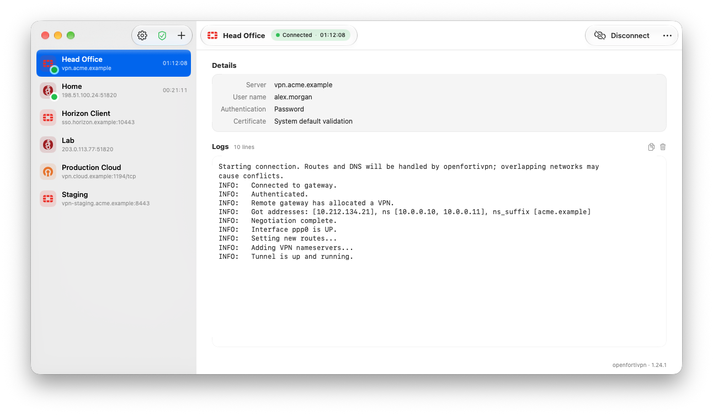
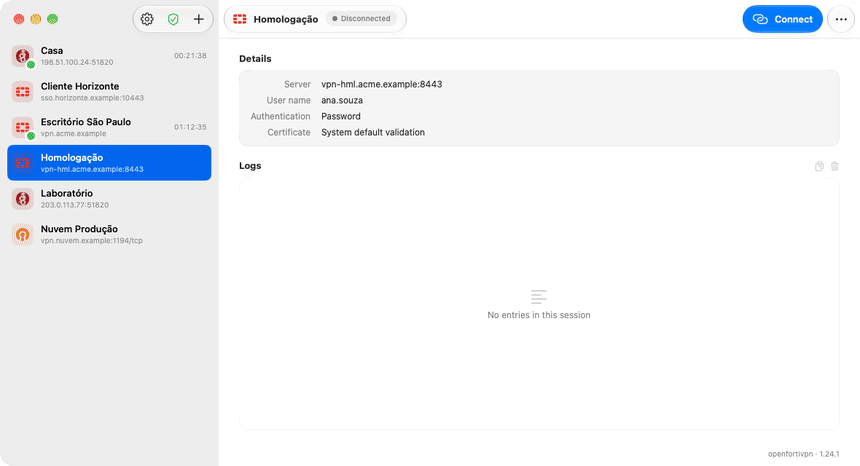
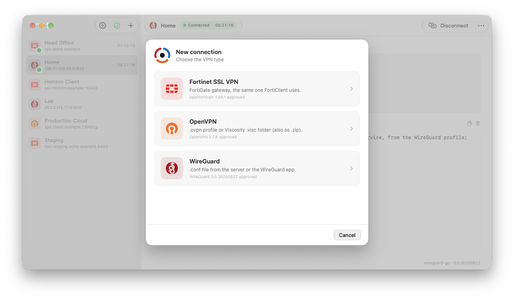
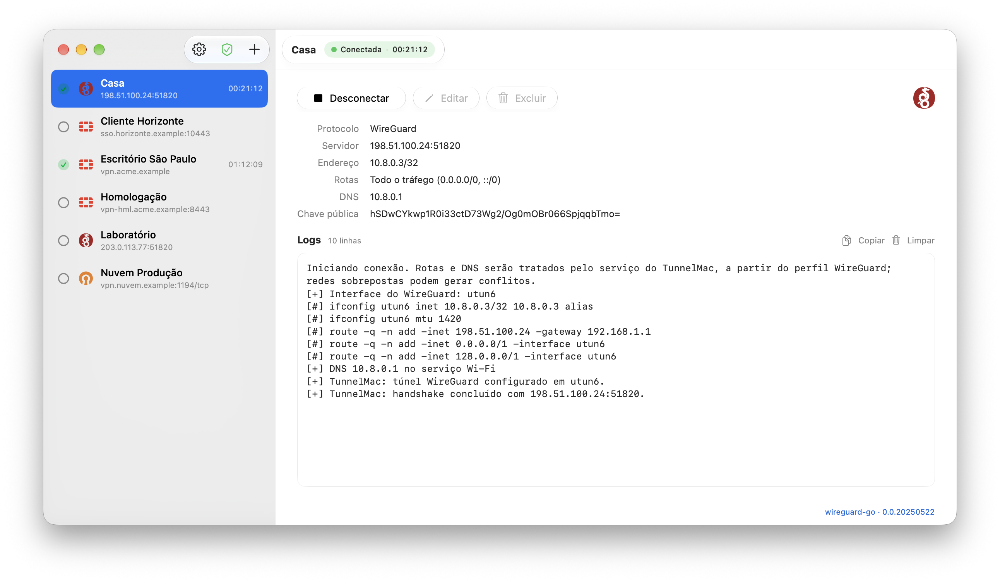
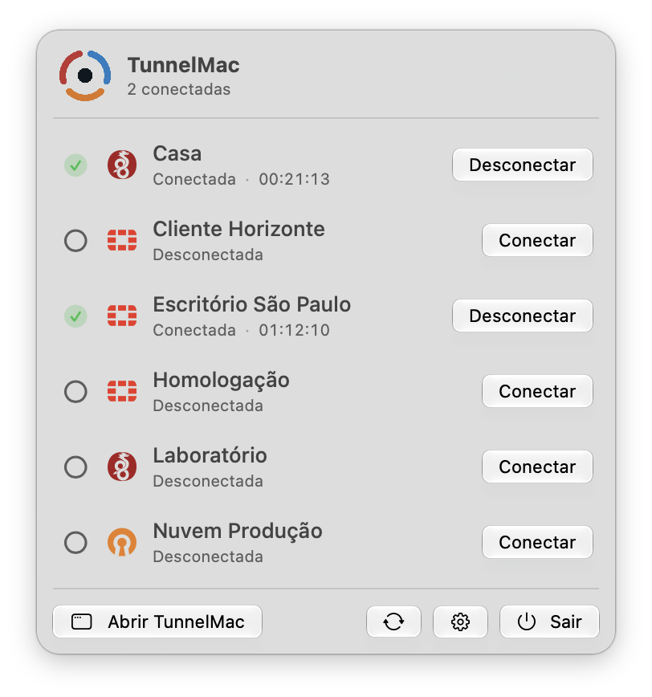

<p align="center">
  <picture>
    <source media="(prefers-color-scheme: dark)" srcset="TunnelMac-Brand/01-Logo/PNG/TunnelMac-logo-horizontal-color-dark.png">
    
  </picture>
</p>

<p align="center">
  <b>One native Mac app for your Fortinet, OpenVPN and WireGuard connections.</b><br>
  Connect from the menu bar. No admin password on every connect. Nothing bundled you didn't approve.
</p>

<p align="center">
  <a href="https://github.com/luizmz94/tunnelmac/releases"></a>
  
  
  <a href="https://github.com/luizmz94/tunnelmac/actions/workflows/checks.yml"></a>
  <a href="LICENSE"></a>
</p>

<p align="center">
  <picture>
    <source media="(prefers-color-scheme: dark)" srcset="docs/assets/main-dark.png">
    
  </picture>
</p>

## Why TunnelMac

- **Three protocols, one list.** [openfortivpn](https://github.com/adrienverge/openfortivpn) for Fortinet SSL VPN (password, SAML or client certificate), [OpenVPN](https://openvpn.net/community/) 2.7+ profiles and [WireGuard](https://www.wireguard.com) `.conf` files.
- **Several tunnels at once.** Each connection has its own session, timer and live log.
- **Lives in the menu bar.** Close the window and your VPNs keep running.
- **Secure by design.** Passwords and SAML sessions stay in Keychain. A small signed helper starts only the VPN clients you approved, and checks them before every connection.
- **Native.** SwiftUI and AppKit, Liquid Glass on macOS 26, light and dark mode.

<p align="center">
  
</p>

## Install

```sh
brew install --cask luizmz94/tunnelmac/tunnelmac
```

Then install the clients you use:

```sh
brew install openfortivpn   # Fortinet
brew install openvpn        # OpenVPN 2.7+
brew install wireguard-go   # WireGuard
```

**First run:** open **Configurações… → Serviço privilegiado**, click **Ativar serviço**,
allow TunnelMac in System Settings → General → Login Items, then approve each VPN client
with an administrator account. You only do this once per macOS user.

> [!NOTE]
> TunnelMac is a release candidate on the way to 1.0. It runs on Apple Silicon and Intel
> Macs; Homebrew picks the right build. On Intel, Homebrew no longer ships prebuilt
> packages for every client, so `brew install` may compile them (OpenVPN takes a while).
> See [Releases](https://github.com/luizmz94/tunnelmac/releases) for manual downloads
> and checksums.

## Screenshots

<table>
  <tr>
    <td align="center" width="50%">
      <picture>
        <source media="(prefers-color-scheme: dark)" srcset="docs/assets/new-connection-dark.png">
        
      </picture>
      <br><sub>Add a Fortinet gateway or import an OpenVPN / WireGuard profile</sub>
    </td>
    <td align="center" width="50%">
      <picture>
        <source media="(prefers-color-scheme: dark)" srcset="docs/assets/wireguard-dark.png">
        
      </picture>
      <br><sub>Routes, DNS and the public key of a WireGuard profile</sub>
    </td>
  </tr>
  <tr>
    <td align="center" colspan="2">
      <picture>
        <source media="(prefers-color-scheme: dark)" srcset="docs/assets/menubar-dark.png">
        
      </picture>
      <br><sub>Connect and disconnect anything from the menu bar</sub>
    </td>
  </tr>
</table>

<sub>All screenshots use fictitious connections (`./scripts/showcase.sh`).</sub>

## Good to know

- **Not a kill switch.** If a tunnel drops, traffic may continue over your normal network.
- **Overlapping networks** between simultaneous VPNs are not resolved automatically.
- **Profiles are checked on import.** OpenVPN scripts, plugins and weak TLS settings, and
  WireGuard `PostUp`-style commands, are removed or refused, never silently weakened.
- **Updates are announced, never installed for you.** Upgrade with
  `brew upgrade --cask luizmz94/tunnelmac/tunnelmac` after quitting with **Sair**.
- **Moving to another Mac?** **Configurações… → Backup** exports every connection,
  password and profile to one password-encrypted file, and imports it on the other Mac.
- **Before uninstalling,** use **Configurações… → Serviço privilegiado → Remover serviço**.

The [guide](docs/GUIDE.md) covers each protocol, where data is stored, updates, migration
from OpenFortiDesk and removal.

## Contributing

Bug reports, ideas and pull requests are welcome. [CONTRIBUTING.md](CONTRIBUTING.md) shows
how to set up the project, run it with demo data and run the tests in a few minutes.

Security issues: see [SECURITY.md](SECURITY.md).

---

<sub>MIT licensed. See [THIRD_PARTY_NOTICES.md](THIRD_PARTY_NOTICES.md). TunnelMac (formerly
OpenFortiDesk) is independent of, and not affiliated with, Fortinet, OpenVPN Inc., the
WireGuard project or openfortivpn. No VPN executable or Homebrew library is bundled.</sub>
